# Processing jobs and optimization

## Spark offline path

The baseline is a direct recursive Parquet read followed by a regular join,
deduplication and Delta overwrite. On the generated distribution this exposes
four problems: 80% of volume belongs to VN30, the ticker/date key has 72,000
values, v1 and v2 have different physical schemas, and 1,440 rows repeat an
existing business key.

The implemented path is:

1. `jobs/bronze/offline.py` reads Hive-style partitions recursively with schema
   merge and reconstructs `trade_date`/`schema_version` from paths.
2. Each version is checked against its JSON contract before Bronze is written.
   Populated unknown columns fail the task; all-null columns introduced by
   merged v1/v2 Parquet schemas are accepted.
3. `jobs/silver/daily.py` unions v1/v2 by name, fills planned v1 fields with
   nulls and applies deterministic `(ticker_id, trade_date)` deduplication.
4. Spark AQE, skew join handling and partition coalescing are enabled in
   `jobs/spark_session.py`. Small ticker/date dimensions use broadcast joins;
   fact tables remain partitioned by `trade_date`.
5. Cardinality checks use a composite ticker/date expression, rather than
   independently counting the two columns.

Relevant Spark settings:

```text
spark.sql.adaptive.enabled=true
spark.sql.adaptive.skewJoin.enabled=true
spark.sql.adaptive.coalescePartitions.enabled=true
spark.sql.autoBroadcastJoinThreshold=50MB
spark.databricks.delta.schema.autoMerge.enabled=false
```

`autoMerge=false` is deliberate: planned schema evolution passes through
versioned contracts instead of silently accepting an unregistered field.

Airflow integration is split into DP1 `bronze_offline_ingest`, DP2
`silver_daily`, and DP2 `gold_dimensions_and_facts`; every DAG contains ingest
and validation tasks.

### Spark compute-layer optimization

The following settings and transformations are implemented. The repository
also contains `scripts/spark_ui_capture.py` for an identical
baseline/optimized workload.

#### Shuffle — why it matters

Shuffle is the most expensive operation in Spark. When you call `groupBy(key)`,
`join`, or `repartition`, Spark redistributes all rows across executors so that
rows with the same key land on the same machine:

```
Before shuffle:
  Executor 1: [VNM, HPG, VNM, ACB, HPG]   ← each ticker scattered across executors
  Executor 2: [VNM, ACB, HPG, VNM, ACB]

After shuffle:
  Executor 1: [VNM, VNM, VNM, VNM]        ← all rows for one key on one executor
  Executor 2: [HPG, HPG, HPG]
```

Every row must be serialized, sent over the network, and deserialized. The project
uses four strategies to reduce or eliminate this cost.

---

#### Strategy 1: Broadcast join — eliminate shuffle entirely

When one side of a join is small enough to fit in executor memory, send a full copy
to every executor instead of shuffling both sides:

```
SortMergeJoin (with shuffle):               BroadcastHashJoin (no shuffle):
  fact (1M rows) ──shuffle──┐                dim (400 rows) ──copy to all executors──┐
                             ├──► join                                           ├──► join
  dim  (400 rows) ──shuffle──┘                fact (1M rows) ──stays in place──────┘
```

The project configures **two layers** of broadcast:

| Layer | Mechanism | Where |
|-------|-----------|-------|
| **Auto** | `spark.sql.autoBroadcastJoinThreshold=50MB` — Spark estimates table size at planning time; tables below this threshold are broadcast automatically without any code change | `jobs/spark_session.py:34` |
| **Explicit hint** | `F.broadcast(table)` — forces broadcast regardless of estimated size, bypasses the optimizer. Used when the developer _knows_ a table is tiny, in case the estimate is wrong | `jobs/gold/facts.py:172-180` (dim_ticker, dim_date, dim_session), `jobs/gold/obt.py:33` (dim_ticker) |

Having both layers is deliberate: the threshold is a safety net for _every_ join in
the pipeline. Explicit hints are the hard guarantee on the joins that matter most —
dimension tables where a wrong choice means a full shuffle of millions of fact rows.

Why dim_ticker (~400 rows) needs an explicit hint even though it's well under 50 MB:
after column pruning and filtering (`is_current = true`), the optimizer may
underestimate or overestimate the size. The hint removes the ambiguity.

---

#### Strategy 2: AQE skew join — automatically split hot partitions

When a join or group-by key is unevenly distributed, one partition receives
disproportionate data. VN30 tickers (30 out of ~400) carry 80% of volume:

```
groupBy("ticker_id").agg(sum("volume"))
  →
  Partition VNM: ████████████████████████  800MB  → 1 overloaded task
  Partition HPG: ██████                     200MB
  Partition 3-200: ▏ ▏ ▏                    ~10MB each → idle
```

AQE (Adaptive Query Execution) monitors shuffle output at runtime. If a partition
exceeds both thresholds below, Spark splits it into smaller pieces and processes
each piece in parallel:

```python
# jobs/spark_session.py:29-33
.config("spark.sql.adaptive.enabled", "true")
.config("spark.sql.adaptive.skewJoin.enabled", "true")
.config("spark.sql.adaptive.skewJoin.skewedPartitionFactor", "5")   # size / median > 5×
.config("spark.sql.adaptive.skewJoin.skewedPartitionThresholdInBytes", "256MB")  # AND > 256MB
```

Both conditions must be true. With the coursework dataset, the volume threshold
(256 MB) may not be hit, so `scripts/spark_ui_capture.py` lowers it to 256 KB
and the factor to 2× to make the split visible on the smaller dataset:

```python
# scripts/spark_ui_capture.py:58-60 (optimized mode — low evidence thresholds)
"spark.sql.adaptive.advisoryPartitionSizeInBytes": "512KB",
"spark.sql.adaptive.skewJoin.skewedPartitionFactor": "2",
"spark.sql.adaptive.skewJoin.skewedPartitionThresholdInBytes": "256KB",
```

After AQE splits the hot partition:

```
  Partition VNM_piece_1: ████  100MB → task 1
  Partition VNM_piece_2: ████  100MB → task 2
  ... (8 pieces total, running concurrently)
  Other partitions: unchanged
```

Result: the longest task no longer dominates the total job time. Spark UI shows
`AQEShuffleRead` with `isSkew=true` in the optimized physical plan.

**Why not manual salting?** Salting requires the developer to know which keys are
hot ahead of time, add a random salt column, join on the salted key, then drop the
salt. It works but clutters business logic and breaks when the hot keys change.
AQE does the same job automatically at runtime with zero code changes. The project
chooses AQE because the coursework intent is to demonstrate that the engine can
handle skew without manual intervention.

---

#### Strategy 3: AQE coalesce — reduce post-shuffle partition count

`spark.sql.shuffle.partitions=200` means every `groupBy` or `join` produces 200
output partitions. On the coursework-sized dataset (~100K rows), most of those 200
partitions are nearly empty:

```
After shuffle (200 partitions, 100K rows):
  [█ 500] [█ 480] [▏ 30] [▏ 12] [▏ 8] ... [0] [0]
```

Running 200 tiny tasks wastes scheduling overhead and I/O. AQE coalesce reads the
actual partition sizes after shuffle completes and merges small neighbours:

```python
# jobs/spark_session.py:30
.config("spark.sql.adaptive.coalescePartitions.enabled", "true")
```

```
After AQE coalesce:
  [████████ 2000] [████████ 1800] [█████ 1200]
  → 200 tasks → ~8 tasks, each processing a meaningful chunk
```

This reduces task scheduling overhead, metadata operations, and small-file I/O
without the developer having to guess the right `shuffle.partitions` value for the
current data size.

---

#### Strategy 4: Partition by date, not by skewed key

Fact and OBT tables are partitioned by `trade_date`, not by `ticker_id`:

```python
# jobs/gold/facts.py:107
fact.write.format("delta").partitionBy("trade_date").save(out)
```

If partitioned by `ticker_id`, the storage itself would be skewed: VNM's partition
would hold 500 MB, while 370 tickers would share the remaining disk. Partitioning
by `trade_date` gives each partition roughly equal size (~400 tickers per day) and
enables partition pruning for date-range queries.

---

#### Strategy 5: Window dedup — deterministic deduplication

When the generator injects 2% duplicate `(ticker_id, trade_date)` pairs, the
pipeline must keep exactly one row. `dropDuplicates()` is not deterministic — it
keeps whichever row the executor encounters first:

```python
# jobs/silver/daily.py:36-45 — deterministic alternative
window = Window.partitionBy("ticker_id", "trade_date").orderBy(F.desc("_ingested_at"))
result = df.withColumn("_rn", F.row_number().over(window))
          .filter(F.col("_rn") == 1)
          .drop("_rn")
```

The `row_number()` window with `orderBy(desc("_ingested_at"))` guarantees the
**most recently ingested row survives**, regardless of execution order. This makes
the result identical on every rerun.

#### Schema Evolution — versioned contracts over silent merge

Schema v1 (7 columns) and v2 (9 columns) arrive in the same landing directory.
`mergeSchema=true` would silently fill `value` and `foreign_room` with nulls for
v1 rows, leaving downstream consumers unable to distinguish "missing by design
(v1)" from "missing by error (generator bug)."

The fix operates in three stages:

1. **Bronze** — `read_landing_parquet()` uses `mergeSchema=true` only to load
   heterogeneous files into a single DataFrame. Rows are then separated by their
   path-derived `_schema_version` and validated against their respective JSON
   contract. v1 and v2 are written to _separate_ Delta tables. Code:
   `jobs/bronze/offline.py:37-129`.

2. **Silver** — `read_bronze_ohlcv()` unions both tables with
   `unionByName(allowMissingColumns=True)` and fills planned v1-absent columns
   with typed nulls. At this point consumers know that `value=NULL` for rows with
   `_schema_version=1` is by design. Code: `jobs/silver/daily.py:15-33`.

3. **Prevention** — `spark.databricks.delta.schema.autoMerge.enabled=false` is set
   on the shared Spark session. Every schema change must pass through an explicit
   contract version. Code: `jobs/spark_session.py:28`.

#### High Cardinality — approximation for distinct counts

`countDistinct(trade_id)` over millions of rows triggers a full shuffle-and-sort.
The Silver validation task computes both `approx_count_distinct` (HyperLogLog,
no full shuffle) and exact counts, then checks the approximation against the
expected 72,000-key coursework result. Downstream consumers see the approximation
flag and can choose between speed and precision.

#### Summary of Spark compute configurations

| Config | Value | Strategy served |
|--------|-------|-----------------|
| `spark.sql.adaptive.enabled` | `true` | 2 (skew join), 3 (coalesce) |
| `spark.sql.adaptive.skewJoin.enabled` | `true` | 2 |
| `spark.sql.adaptive.skewJoin.skewedPartitionFactor` | `5` | 2 |
| `spark.sql.adaptive.skewJoin.skewedPartitionThresholdInBytes` | `256MB` | 2 |
| `spark.sql.adaptive.coalescePartitions.enabled` | `true` | 3 |
| `spark.sql.autoBroadcastJoinThreshold` | `50MB` | 1 |
| `spark.sql.shuffle.partitions` | `200` | Baseline for 3 |
| `spark.databricks.delta.schema.autoMerge.enabled` | `false` | Schema evolution |
| `autoBroadcastJoinThreshold=-1` (capture baseline) | — | Proves 1 is necessary |
| Partition `by("trade_date")` on fact tables | — | 4 |

The repository contains the same-workload capture runner described below. The
Spark Master page at port 8080 only proves cluster availability; the driver UI at
port 4040 (SQL plans, Stages, task duration distribution) is what proves the
optimization works.

## Spark UI evidence — baseline vs optimized

Script `scripts/spark_ui_capture.py` chạy cùng một workload trong 2 chế độ:
**baseline** (tắt hết optimization) và **optimized** (bật hết). Dữ liệu đầu vào,
số shuffle partition (32), và logic transform giữ nguyên — chỉ các config AQE,
skew handling, partition coalescing và broadcast thay đổi.

### Baseline — tất cả optimization tắt

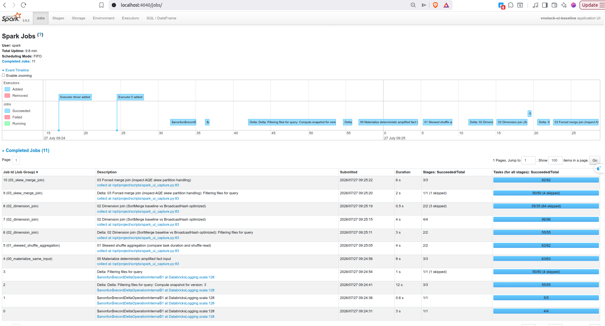

*Figure 6 — Baseline Spark Jobs tab (`:4040`). Job groups
`01_skewed_shuffle_aggregation` và `02_dimension_join` hiển thị `SortMergeJoin`
trong physical plan. Task nặng nhất chiếm phần lớn tổng thời gian do dữ liệu
phân bố lệch (skew).*

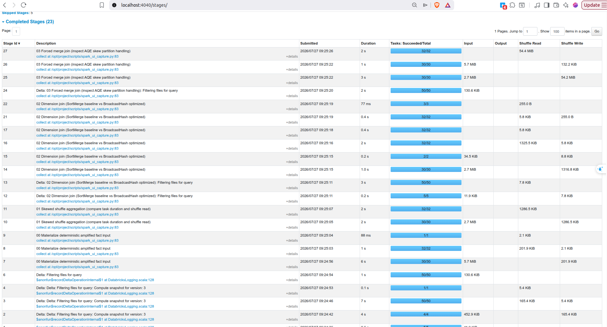

*Figure 7 — Baseline Spark Stages tab (`:4040`). Phân bố task duration thể hiện
skew rõ rệt: task xử lý partition VN30 mất 10×–50× thời gian so với các task còn
lại. Shuffle read tập trung vào một vài task, các task khác gần như trống.*

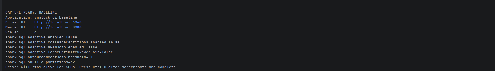

*Figure 8 — Baseline terminal output. Configuration summary xác nhận
`spark.sql.adaptive.enabled=false`, `spark.sql.autoBroadcastJoinThreshold=-1`.
Plan highlights chỉ hiển thị `SortMergeJoin`, không có adaptive intervention.*

### Optimized — AQE và broadcast bật

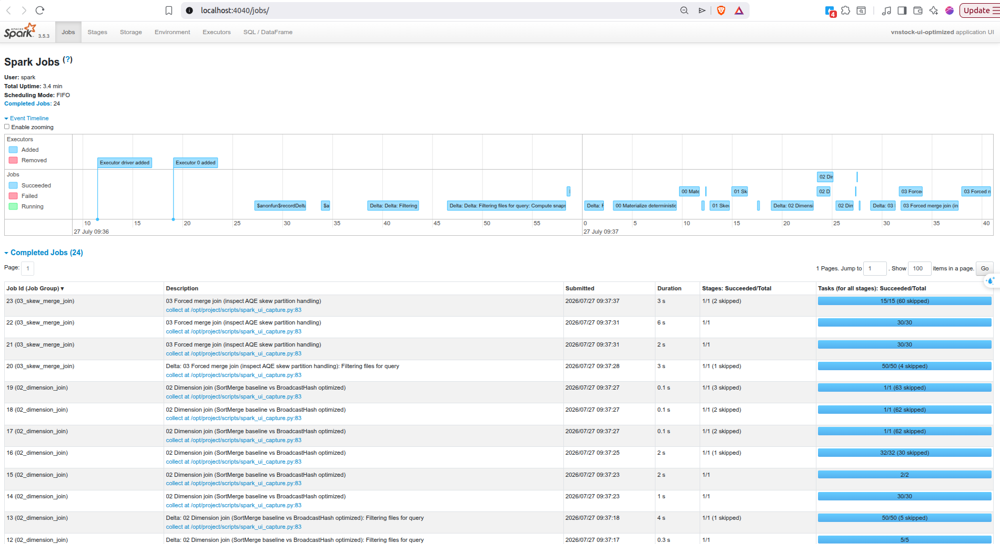

*Figure 9 — Optimized Spark Jobs tab (`:4040`). Cùng workload với AQE bật.
`BroadcastHashJoin` thay thế `SortMergeJoin` cho dimension join;
`AdaptiveSparkPlan` xác nhận query plan được điều chỉnh lại ở runtime.*

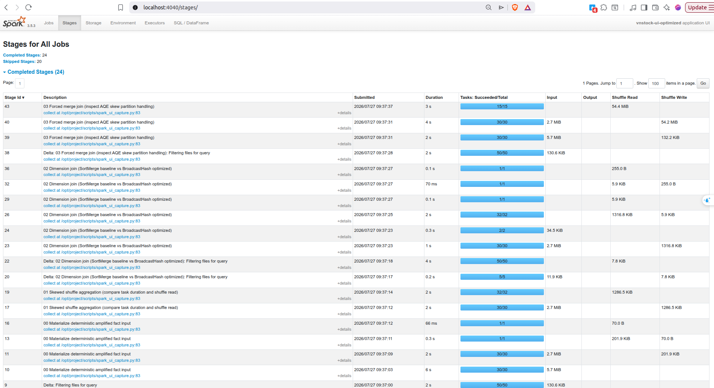

*Figure 10 — Optimized Spark Stages tab (`:4040`). Task duration phân bố đồng
đều. AQE skew join tự động tách partition HOT thành các piece cân bằng;
`AQEShuffleRead` với `isSkew=true` xác nhận skew đã được phát hiện và xử lý.*

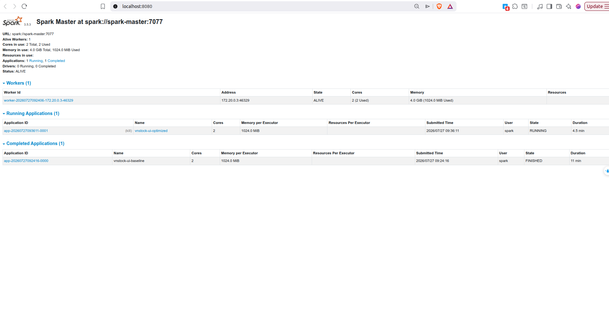

*Figure 11 — Spark Master UI (`:8080`). Application `vnstock-ui-optimized` đang
chạy trên standalone cluster. Master UI chứng minh cluster hoạt động; Driver UI
tại `:4040` (Figures 9–10) chứng minh optimization hiệu quả.*

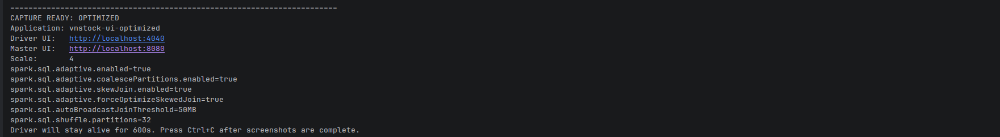

*Figure 12 — Optimized terminal output. Configuration xác nhận
`spark.sql.adaptive.enabled=true`, `spark.sql.autoBroadcastJoinThreshold=50MB`.
Plan highlights hiển thị `BroadcastHashJoin`, `AdaptiveSparkPlan`, và
`AQEShuffleRead`.*

## Flink streaming path

The source sends a baseline 200 events/minute and auction bursts near 5,000
events/minute. Arrival records are sorted by `created_ts`; 12% have event time
5–45 seconds behind arrival and 1.5% replay a prior `event_id`. The Kafka
record timestamp is the payload `event_timestamp`, so Flink receives event time
at the source boundary. Topic `stock_market_events_v3` has four
ticker-keyed partitions and `retention.ms=-1`; infinite retention is required
because the deterministic replay uses historical 2025 event timestamps.

`jobs/flink/silver_stream.py` implements:

- four source/processing subtasks, sized for the burst;
- a 60-second bounded-out-of-orderness watermark;
- keyed state deduplication (`first event_id wins`);
- a typed quarantine side output for records beyond watermark plus grace;
- a five-minute event-time tumbling window for trade volume;
- checkpointed JSONL `FileSink` outputs for Silver, quarantine and features.

The running application was submitted with:

```bash
docker compose exec -T flink-jobmanager flink run -d \
  -py /opt/project/jobs/flink/silver_stream.py \
  --kafka-broker kafka:29092 \
  --topic stock_market_events_v3 \
  --group-id flink-silver-stream-v10-final \
  --output-dir /opt/flink/data/final_v10
```

Airflow's `flink_silver_stream` DAG checks the Flink REST endpoint and fails
unless exactly one application named `flink-silver-stream` is running. The
long-lived application itself is started once from the deployment command
above, rather than nesting Docker control inside an Airflow worker.

For evidence, capture Flink UI's job graph, checkpoint page, backpressure page
and task metrics after Kafka lag reaches zero.

### Flink reference execution

| Counter/state | Verified value |
|---|---:|
| Job ID | `377ab5e5eb029d8f905db390c54549b6` |
| Source records | 197,925 |
| Records after event-id dedup | 195,000 |
| Trade-window input | 165,668 |
| Five-minute feature windows | 17,845 |
| Final watermark | `1760021038999` = 2025-10-09 14:43:58 UTC |

The complete counter reconciliation is in
[`evidence/flink_v10_verification.md`](evidence/flink_v10_verification.md).

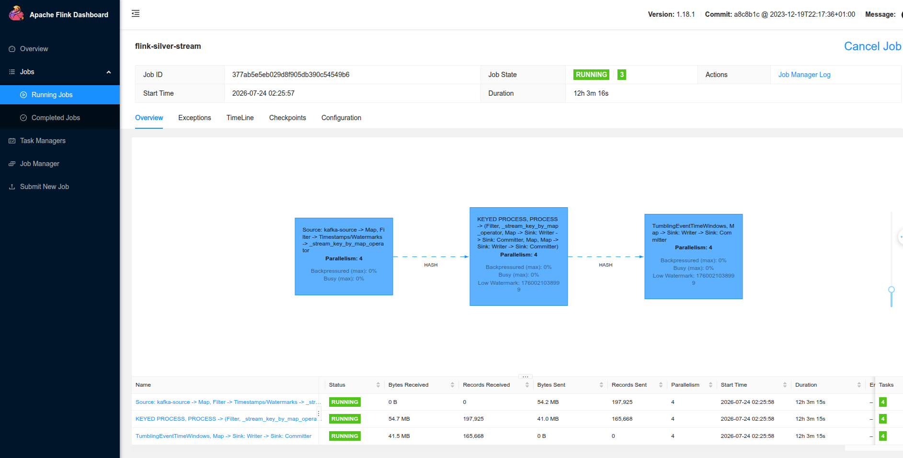

*Figure 1 — Flink job `377ab5e5eb029d8f905db390c54549b6`
is RUNNING. Three vertices at parallelism four account for 12 running tasks:
Kafka source/timestamp-watermark assignment, keyed processing and file sinks,
then five-minute tumbling event-time windows. The table shows 197,925 source
records and 165,668 records entering the window vertex.*

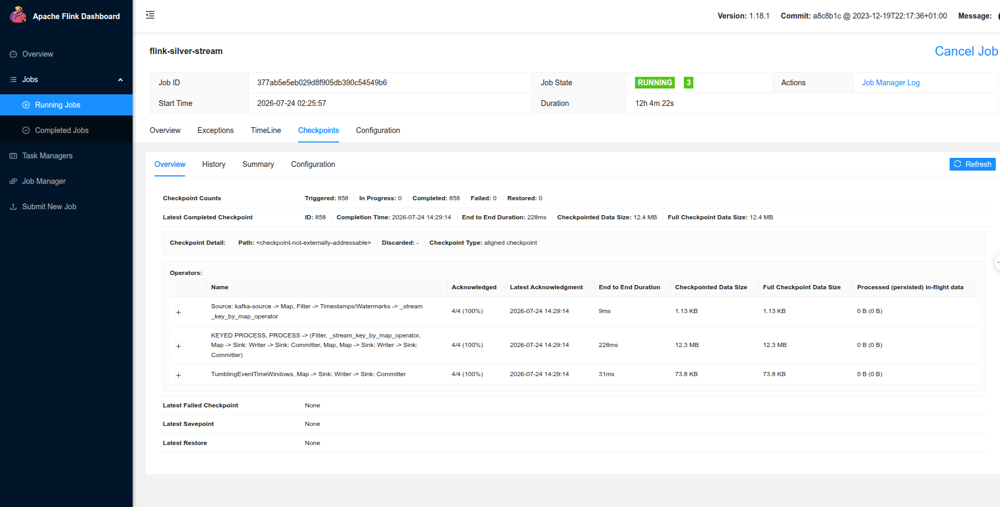

*Figure 2 — Later checkpoint snapshot of the same job: 858 triggered and 858
completed, zero failed, zero in progress. Each of the three operators
acknowledged 4/4 subtasks; checkpoint 858 completed in 228 ms with 12.4 MB
state. This later UI snapshot supersedes the earlier 23-checkpoint count in
the initial verification note without changing the job result.*

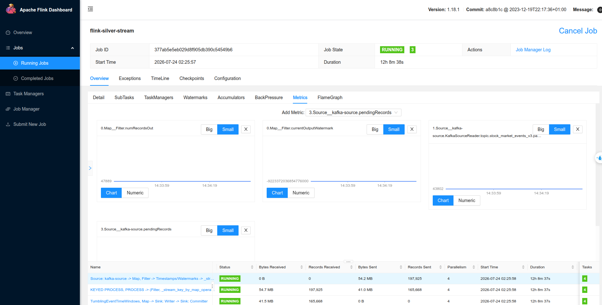

*Figure 3 — Source-vertex Metrics view with per-subtask `numRecordsOut`,
watermark, Kafka offset and pending-record metric selections. The table below
provides the aggregate 197,925 source records and 165,668 process output. The
watermark chart in this particular capture shows an idle/minimum sentinel,
so the final aggregate watermark is taken from the Overview graph in Figure 1
and reconciled in `flink_v10_verification.md`; this figure alone is not used
to claim the final watermark.*

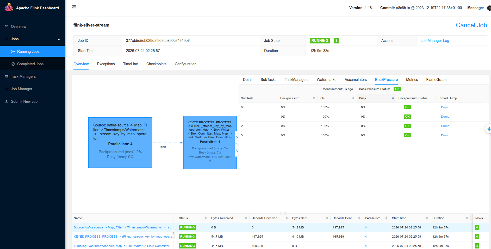

*Figure 4 — Source backpressure inspection after the finite replay drained:
all four subtasks are OK, 0% backpressured, 100% idle and 0% busy. This proves
the final drained state; it does not measure backpressure during the auction
burst itself.*

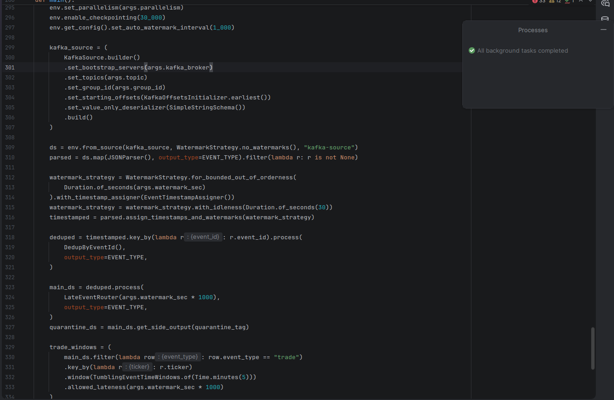

*Figure 5 — Implemented PyFlink pipeline around lines 295–333:
parallelism/checkpointing, bounded-out-of-orderness watermark assignment,
`key_by(event_id)` stateful deduplication, late-event routing, and keyed
five-minute `TumblingEventTimeWindows` with allowed lateness.*

## Streaming optimization (Watermark, Burst, Windows)

Evidence is Figures 1–5 above; these show the final running
job, counters, checkpoints, drained-state backpressure and PyFlink code. There
is no before/after burst backpressure capture.

### Late Arrival Handling (12%, 5–45s)

**Problem:** 12% of events have `created_ts` 5–45 seconds later than `event_timestamp`, clustered in burst windows. Processing-time windows assign events to wrong windows.

**Fix — event-time processing with watermark:**
- Watermark strategy: `watermark = event_timestamp - 60s` (covers 5–45s range with margin)
- Allowed lateness: 60s on windowed aggregations — events within bound trigger window recomputation (late firing)
- Events beyond allowed lateness: routed to **side output** (`lateOutputTag`) → `stg_events_quarantine`
- This maps directly to: watermark strategy + allowed lateness + side output = the Flink API surface for "late events within bound merge; later events go to quarantine"

### Burst Handling (200 → 5,000 events/min, ×25)

**Problem:** ATO/ATC auction windows produce ×25 baseline volume, causing backpressure on single partition.

**Fixes implemented:**

1. Kafka topic `stock_market_events_v3` has **four** ticker-keyed partitions.
2. Source, keyed process and window vertices each run at parallelism four,
   giving 12 running tasks and letting all partitions consume concurrently.
3. Checkpointed file sinks commit replay output consistently.

The job has no external enrichment call and therefore no `AsyncDataStream`
stage.

### Window Processing

| Feature | Window Type | Size | Slide | Key | Code |
|---------|------------|------|-------|-----|------|
| `f_stream_volume_5m` | Tumbling event time | 5 min | — | ticker | `jobs/flink/silver_stream.py` and Spark fallback |
| `f_stream_trade_count_30m` | Sliding event time | 30 min | 1 min | ticker | `jobs/features/stream.py` |

The generator emits no lunch-break events, so windows naturally produce no
rows during that gap. No separate Flink session-gap operator is implemented.

### Duplicate Handling (1.5%)

**Fix:** Dedup by `event_id` in a `KeyedProcessFunction`; the implemented
PyFlink path keeps the first arrival and suppresses later replays.
